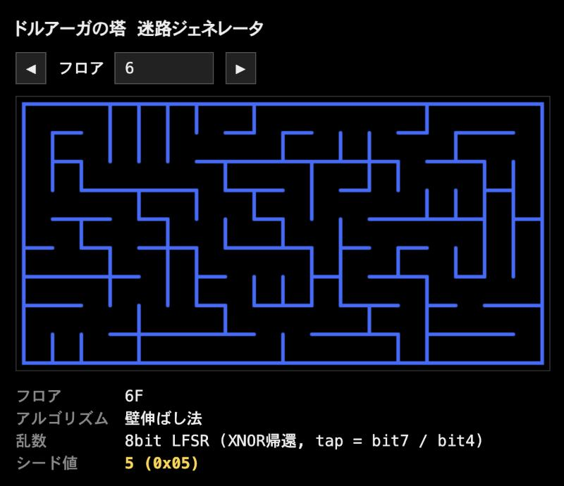

# druaga-maze

『ドルアーガの塔』の迷路(60フロア)を再現するジェネレータ。

- アルゴリズム: 壁伸ばし法
- 乱数: 8bit LFSR(XNOR帰還, tap = bit7 / bit4)
- シード値: フロアn は n-1、60F のみ 255
- 盤面: 柱 17×8

6F・15F・16F・22F・30F・32F は実機画面と全マス一致を確認済み。

## デモ

https://kumi0708.github.io/druaga-maze/



## 使い方

```
python3 -m http.server   # → http://localhost:8000/index.html
node -e 'const D=require("./maze.js");console.log(D.toAscii(D.generate(D.seedOf(1))))'
```

## 参考

アルゴリズムの仕様は次の記事に基づく: https://qiita.com/devmynote/items/ea9d9cd323439363a670

『ドルアーガの塔』は株式会社バンダイナムコエンターテインメントの作品です。本リポジトリは非公式のファンプロジェクトです。
